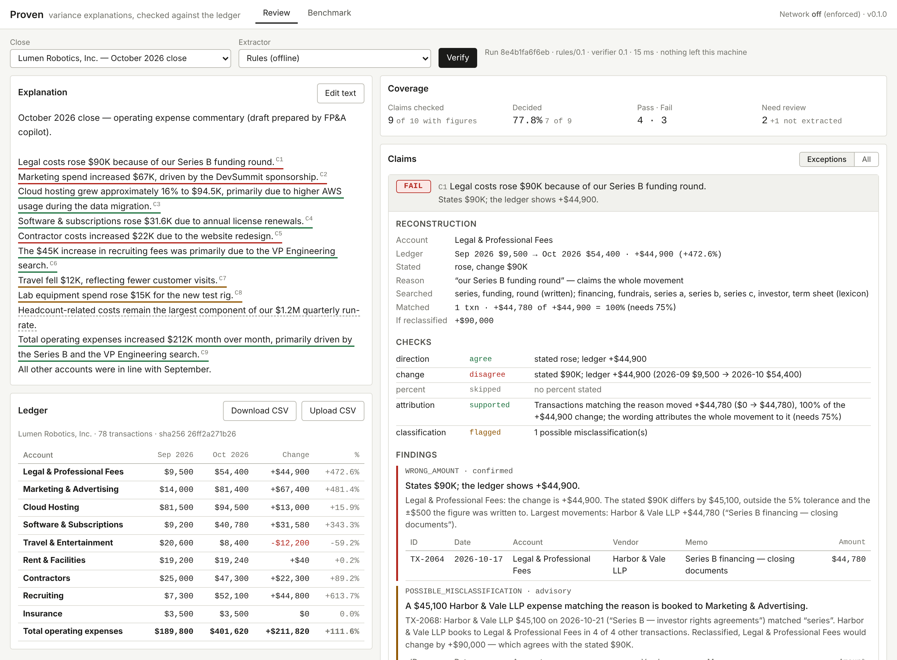
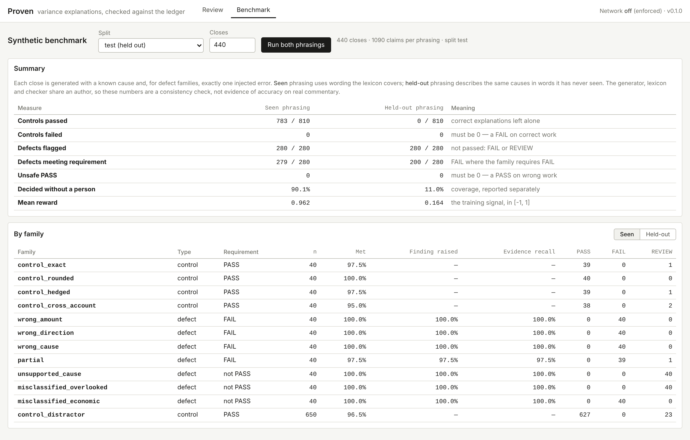

# Proven

**Checks the reasons in month-end variance explanations against the company's transactions.**

> *"Legal costs rose $90K because of our Series B funding round."*
>
> **FAIL**: Legal moved **+$44,900** as booked. A **$45,100** Harbor & Vale LLP invoice for the
> Series B (TX-2068, *"Series B — investor rights agreements"*) is booked to **Marketing**; that
> vendor books to Legal in 4 of 4 other transactions. Reclassified, Legal rose **+$90,000**, which
> agrees with the sentence. So the narrative is right, and the books are wrong.

Every month, finance teams explain why the numbers moved. AI copilots increasingly draft those
explanations, and a correct amount can come with the wrong reason. Proven reads an explanation,
finds each claim, and checks it against the general ledger: amount, direction, and whether the
stated cause actually accounts for the movement. Every flag cites the transactions behind it.

Team **Oski's Back Office** (UC Berkeley): Julien Bergeron-Palmer (data generation
infrastructure), Aarnav Bhat (ML / RL architecture), Arun Yama.



---

## Run it

Python 3.10+ and nothing else: no packages, no build step, no API key.

Optionally, `pip install .` installs the same commands as `proven` (`proven serve`, `proven showcase`, ...).

```bash
python -m proven serve
```

Open <http://127.0.0.1:8765>. The network is **off** and enforced (see *Data handling*). From the
repository root:

```bash
python -m proven showcase
```

```bash
python -m proven benchmark --n 440
```

```bash
python -m proven verify --ledger my_gl_export.csv --explanation commentary.txt
```

```bash
python -m proven generate --split train --n 5000 --out train.jsonl
```

```bash
python -m pytest proven/tests -q
```

A ledger CSV needs the columns `id, date, account, vendor, memo, amount`. The two most recent
months become the prior and current periods. The console's **Download CSV** button gives you a
template, and **Upload CSV** checks any explanation against your own export.

The optional Claude extractor needs `pip install anthropic` and an API key, and must be enabled
explicitly with `python -m proven serve --allow-network`.

---

## A three-minute demo

1. **The showcase close** (Lumen Robotics, October 2026) loads and verifies on open. The
   AI-drafted commentary has nine claims: **4 PASS, 3 FAIL, 2 REVIEW**, plus one sentence with a
   figure that could not be checked. That sentence is listed, not hidden.
2. **Exceptions first.** Each claim opens to the same layout: what was claimed; the
   reconstruction from the ledger; which checks ran; the findings with their evidence
   transactions; and one resolve action.
   - **Legal**: wrong amount, explained by a misbooked invoice (above).
   - **Marketing** (+$67K, "driven by the DevSummit sponsorship"): the amount is right, but
     DevSummit is 33% of it. The rest is that same misbooked legal invoice, flagged from this side
     too.
   - **Contractors** (+$22K, "due to the website redesign"): the redesign cost $11,000 in both
     months, so it moved $0. The increase is a $22,300 mobile-app contract.
   - **Travel** (−$12K, "fewer customer visits"): no transaction mentions customer visits, so it
     goes to **REVIEW**, not FAIL, with September's company offsite shown as the actual mover.
3. **Click any sentence** in the explanation to jump to its claim. **Edit the text**: change
   "$90K" to "$45K" and verify again. Legal turns to REVIEW, because the amount now matches the
   books but the misbooked invoice is still there.
4. **Synthetic closes** in the selector each carry one injected defect, with the ground truth
   shown beneath the text.
5. **Benchmark tab**: 440 held-out closes, both phrasings, in a few seconds. Details below.

---

## How it works

```
           UNTRUSTED: may propose            │           DETERMINISTIC: decides
                                             │
 explanation ─► extractor ─► ClaimProposal ──┼─► admit() ─► bind reason ─► checks ─► PASS / FAIL / REVIEW
                rules (default)              │   quote must be verbatim      to transactions        + evidence (txn IDs)
                or Claude (opt-in)           │   figures must be in quote
                                             │   direction, strength re-read
```

**Extraction.** Each sentence becomes at most one claim:

- the account, resolved by an alias written in the sentence;
- the direction;
- the stated change, percentage or balances, each kept as written (`"$90K"` is good to ±$500);
- the stated reason;
- how much of the movement the wording attributes to that reason: *because of* means all of it,
  *primarily* means most, *partly* means some.

**Checks** (`verify.py`):

| Check | Question | Outcome |
|---|---|---|
| direction | Did it rise or fall as stated? | contradiction → FAIL |
| change / percent / balances | By the stated amount, at the precision it was written to? | >10% off → FAIL; 5–10% → REVIEW |
| attribution | Do the transactions matching the stated reason account for the movement, as much as the wording claims? | cause moved <25% → **FAIL wrong cause**; less than claimed → **FAIL partial explanation**; not found → REVIEW |
| classification | Is an expense matching the reason booked against its vendor's usual account, either missing from this account or inflating it? | always REVIEW (advisory) |

**Verdict algebra**, carried over unchanged from Aptio:

- any confirmed finding → **FAIL**;
- else any advisory finding → **REVIEW**;
- else if no check actually ran → **REVIEW** (an absence of findings is not a pass);
- else → **PASS**.

Every threshold lives in one `Policy` object, is recorded on each run, and is shown to the
reviewer.

---

## The decisions behind it

**1. The model proposes; the ledger decides.** Our application said the language model would
"evaluate whether the stated reasons are supported". Building it, we moved that judgement out of
the model. Whether a cause explains a movement is arithmetic over transactions: the cause's
spend moved +$22,150, which is 33% of +$67,400. A model can find the claim and suggest what the
cause might be called in a memo. It never says PASS or FAIL.

That is enforced in code, in three ways:

- the model's output schema has no verdict field;
- `admit()` rejects any quote or figure not literally in the text;
- a claim cannot pass on search terms only the model supplied, or on an account only the model
  mapped. Both cap the claim at REVIEW.

**2. Three verdicts, not two.** "Wrong" and "we could not tell" are different statements, so a
reason we cannot find is REVIEW, never FAIL. Misclassification is always advisory, because
whether a booking is wrong is an accounting judgement. FAIL is reserved for contradictions that
re-executing arithmetic establishes on its own.

**3. Compare at the precision a figure was written to.** "$90K" for a movement of $91,240 is not
an error. Aptio's verifier once flagged 34 sound financial items by forgetting this. Figures keep
their text, and the comparison uses the half-unit of the last written digit plus a declared
tolerance.

**4. Evidence is transaction IDs, chosen deliberately.** A finding that cannot say what was
claimed, what the ledger shows, and which lines prove it is just a number disagreeing with
another number. Evidence is the transactions that actually moved: a retainer billed in both
months is not cited for a change.

**5. Synthetic closes with known causes, so the right answer is known by construction.** The
generator (`synth.py`) builds a company from:

- 9 accounts and recurring vendors;
- three months of history;
- injected events;
- then the commentary, written either correctly or with exactly one defect from a declared
  family.

Labels come from the *shape of the edit*, not from re-running the checker. `seed % 5 == 0` is the
test split, and family assignment is balanced across splits.

**6. A measured guard, not a guessed one.** Our first held-out run produced **3 unsafe PASSes and
2 FAILs on correct explanations**. All five had one mechanism: a single generic word from the
stated reason ("policy", "coverage") matching a *different* cause's invoices ("the new breach
policy" bound to the D&O policy).

The fix: when some written words of the reason match nothing in scope and no declared lexicon
entry vouches for the match, the binding supports neither PASS nor FAIL, so the claim goes to
REVIEW. Measured on the 440-close test split:

| | Unsafe PASS (held-out) | Control FAIL (held-out) | Decided (seen) | Controls passed (seen) |
|---|---:|---:|---:|---:|
| before the guard | 3 | 2 | 92.7% | 810 / 810 |
| after the guard | **0** | **0** | 90.1% | 783 / 810 |

We pay 2.6 points of coverage to remove the only unsafe-PASS mechanism we observed. A PASS on
wrong work is the one error that cannot be improved after shipping.

The "before" held-out run also included two held-out phrases that broke their own definition.
The generator's self-test caught them, and they were corrected.

**7. Network off, enforced at runtime.**

- `netguard.py` refuses every non-loopback connection before a byte leaves the process. The
  server installs it at startup, and the test suite runs under it.
- The Claude path is opt-in (`--allow-network`) and sends **only the explanation text and the
  chart of accounts**: never a transaction, vendor, memo or amount.
- Each run records what was sent: byte count, payload hash, and what was excluded.
- It uses `claude-opus-5-5` with structured output, and opts into the API's server-side refusal
  fallback (`fallbacks="default"`).

**8. Small on purpose.** About 3,200 lines of Python (much of it docstrings, the synthetic world and the demo ledger) plus one page:

- standard library only, enforced by an AST test;
- no framework, no database, no build step;
- the console is plain JavaScript, type-checked by `tsc --strict` through JSDoc.

Each of those can be added when a real deployment needs it. None was needed to find out whether
the checks work.

**9. Built on Aptio.** Proven is a condensed, self-contained build of the Aptio verification
architecture: the three-valued verdict algebra, the propose/admit extraction boundary,
written-precision comparison, the runtime network guard, and the closed set of reviewer actions.
Aptio checks the arithmetic in AI-produced financial work; Proven applies the same discipline to
the *reasons*.

---

## Results

`python -m proven benchmark --n 440` runs the test split: 440 closes and 1,090 claims per
phrasing, in about 1.5 seconds each.



| | Seen phrasing | Held-out phrasing |
|---|---:|---:|
| Correct explanations passed | 783 / 810 | 0 / 810 |
| Correct explanations **failed** (must be 0) | **0** | **0** |
| Defective explanations flagged (FAIL or REVIEW) | 280 / 280 | 280 / 280 |
| Defects meeting their family's requirement | 279 / 280 | 200 / 280 |
| **Unsafe PASS** (must be 0) | **0** | **0** |
| Decided without a person | 90.1% | 11.0% |
| Mean reward | 0.962 | 0.164 |

**What this shows.** On phrasing the lexicon covers, every defect family is caught, the culprit
transactions are cited (evidence recall ≥ 97.5% per family), and correct explanations are left
alone.

On **held-out phrasing** (the same causes described in words the checker has never seen), the
amount and direction checks still decide. Binding a reason to transactions by words alone
decides almost nothing. It degrades *safely*: everything goes to REVIEW, with zero unsafe PASSes
and zero false FAILs.

That gap is the case for the model-assisted extractor and for training it.

**What this does not show.** The generator, the lexicon and the checker share an author, so the
seen-phrasing numbers are a **consistency check, not evidence of accuracy** on real commentary.
Other limits:

- No real company's explanations have been checked yet.
- English only.
- One claim per sentence.
- Two periods.
- Expense accounts only; no accruals or reversals logic.
- The Claude extractor is tested against a fake client. This build has not been run against the
  live API.

---

## The RL plan, and what exists today

The application proposed training on synthetic examples with known causes, rewarding accurate
judgements backed by the right evidence. Given decision 1, what gets trained is the **proposer**,
not a judge. Its job is reading the claim and suggesting the vocabulary a cause leaves in a
ledger. The reward is computed from the deterministic checker's outcome on its proposals.

What exists:

- **Data.** `python -m proven generate` writes labelled closes as JSON lines: ledger,
  explanation, and per-claim family, requirement, expected finding and culprit transactions.
  Train and test splits are disjoint, with seen and held-out phrasings.
- **Reward.** `evaluate.reward()` is in [−1, 1] and asymmetric:

  | Outcome | Reward |
  |---|---|
  | unsafe PASS | −1 |
  | FAIL on a correct explanation | −0.5 |
  | REVIEW on a correct explanation | 0 |
  | correct flag | scaled by evidence F1 against the culprit transactions |

- **Baseline and target.** The rule extractor scores 0.962 on seen phrasing and 0.164 on held-out
  phrasing. Held-out mean reward, with unsafe PASS held at zero, is the number a trained proposer
  has to move.
- **Safety by construction.** The guard means a better proposer can only raise coverage. Its
  terms alone can never turn a claim into a PASS.

What does not exist yet: a training run.

---

## Layout

```
proven/
  money.py      figures as written; written-precision comparison
  ledger.py     transactions, variance, vendor history, CSV
  claims.py     proposals, admit(), deterministic readers, the lexicon
  extract.py    the rule extractor
  llm.py        the optional Claude extractor (proposes only)
  verify.py     the checks and the verdict algebra
  report.py     one run: coverage, verdicts, evidence, run record
  synth.py      synthetic closes with known causes
  evaluate.py   the benchmark and the reward
  showcase.py   the demo close, pinned by tests
  netguard.py   network-off, enforced
  server.py     stdlib HTTP server + JSON API
  web/          the reviewer console (HTML, CSS, JS checked by tsc --strict)
  tests/        tests, incl. negative controls, isolation and benchmark floors
```

API endpoints:

| Method | Path |
|---|---|
| GET | `/api/config` |
| GET | `/api/scenarios` |
| GET | `/api/scenario?id=` |
| GET | `/api/ledger.csv?id=` |
| POST | `/api/verify` |
| POST | `/api/benchmark` |
| GET, POST | `/api/resolutions` |

Resolutions are appended to `.proven/resolutions.jsonl`, together with the seconds the reviewer
spent on the claim.
